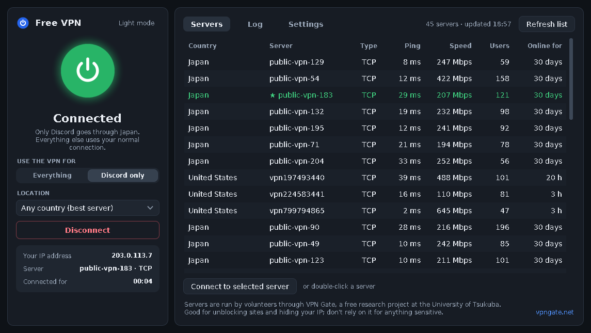

# Free VPN

A small Windows app that connects your PC to free public VPN servers, either for
everything or for **Discord only** (games keep your normal, fast connection).

- **Servers:** [VPN Gate](https://www.vpngate.net/en/), a free research project at the
  University of Tsukuba, Japan. Volunteers around the world run the servers.
- **Connection:** made by [OpenVPN](https://openvpn.net/community-downloads/), the free,
  official open-source VPN client, which you install once.
- No account, no sign-up, no payment.

## Download

Open **[Releases](../../releases/latest)** and download one of these:

| File | What it is |
| --- | --- |
| `FreeVPN.exe` | The app as a single program. Needs OpenVPN installed. |
| `FreeVPN.zip` | The Python version. Needs Python and OpenVPN; see `README.txt` inside. |

Then follow [README.txt](README.txt): it covers setup, Discord-only mode, starting with
Windows, the icon next to the clock and troubleshooting.

## Features

- Quick Connect to the best server, or pick a country or a server from the list
- **Everything** or **Discord only** (routes just Discord through the VPN)
- Remembers the servers that worked (marked ★) and tries them first
- Reconnects by itself if the connection drops
- Icon next to the clock; the X button asks before closing
- Starts with Windows (optional), connects by itself (optional)
- Light and dark theme, sharp on high-DPI screens

## Privacy, honestly

Good for unblocking sites and hiding your IP from the websites you visit. Not for
anything where your safety depends on privacy: VPN Gate's volunteers keep connection
logs for at least two weeks.

## For developers

`FreeVPN.pyw` is the whole app (Python standard library only). The tests are in
[`tests/`](tests/README.md); GitHub runs them on Windows for every push
(see `.github/workflows/windows.yml`), and a version tag such as `v1.4` publishes a
release with `FreeVPN.exe` and `FreeVPN.zip`.
